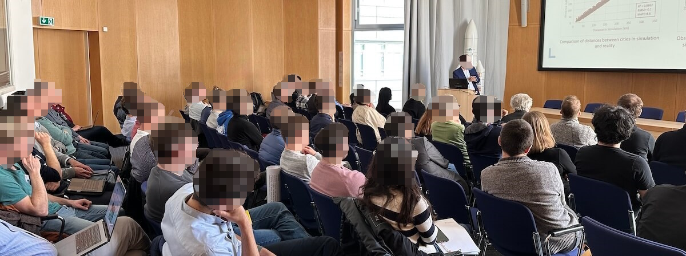
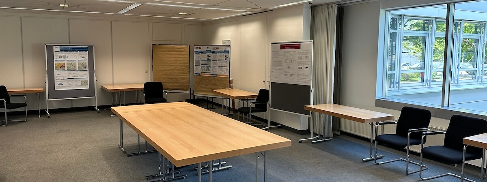

# Save the Date!

June 07-09, 2027, in Berlin.

The SUMO Conference, held every year in Berlin since 2013, is a must-attend event for anyone involved with SUMO. It gathers international participants from the industry, research and public institutions - to present (among others) projects, studies and advancements all around traffic, simulation and SUMO.

The conference offers opportunities to learn about new features, connect with other users, engage with the developers, exchange ideas, and even start new collaborations.

# Call for Papers

The conference focuses on presenting new and unique results in the field of mobility simulation and modelling using openly available tools and data. We expect a large variety of research topics and usage approaches.
Possible areas of interest include (but are not limited to):

- AI-based traffic modelling / AI-assisted simulation
- Data-driven calibration and validation
- Intermodal transport and shared mobility
- Simulation for traffic safety and risk assessment
- Real-time traffic prediction and control
- Large-scale simulation and high-performance computing
- Mobility and demand modelling
- Open tools and open data
- Traffic management solutions
- Sustainable urban traffic planning
- Autonomous driving
- Goods traffic and logistics simulation
- Digital twins in Intelligent transportation systems
- E-Mobility
- Vehicular communication
- Railway simulation

# Submissions

There are two types of submission:

---

**1. Scientific Papers**
   - All accepted scientific papers must be presented at the conference.
   - Papers will be reviewed by at least two reviewers.
   - All accepted papers will be published in the [SUMO Conference Proceedings (SCP)](https://www.tib-op.org/ojs/index.php/scp/index).
   - Papers should be 5-20 pages long.
   - Optional: You can send us the title and a short abstract (up to 300 words) in advance, to receive initial feedback from us. Send it via E-Mail to sumo-conference@dlr.de by sunday, January 17, 2027 - 23:59 UTC.

  Authors are required to use the <a href="https://tib.cloud/s/zdtLMrpD3TR2s7F/download">Word</a> or <a href="https://tib.cloud/s/mjmoRHjz8k3sQmf/download">LaTeX</a> template provided by TIB Open Publishing. 
  <b>Submissions that do not adhere to the specified template will not be considered.</b>

   - **The paper must be submitted in LaTeX or Word before Sunday, February 21, 2027 - 23:59 UTC.**

---

 

**2. Posters**
  - The SUMO conference offers the opportunity to present your work during the poster session.
  - A scientific paper is not required.
  - Posters may present:
    - Bachelor's or Master's thesis results
    - Live Demos
    - SUMO use cases
    - Project presentations
    - Work in progress that would benefit from community feedback
  - Posters must be formatted in A0 size (841 x 1189 mm / 33.1 x 46.8 in). No specific template is required.
  - We will print your poster and provide a display panel, chair, and table.
  - Changes are allowed after the submission deadline, but we cannot reprint revised posters; you will need to bring the updated version yourself.
  - You may bring a laptop or device for demos or supplementary material (please bring your own equipment).
  - **Submit the title and a short abstract (up to 300 words) by Sunday, March 07, 2027 - 23:59 UTC.**

---

## Submission links

- Paper submissions: https://www.tib-op.org/ojs/index.php/scp/about/submissions 
<small>Login or register and then click on <b>"Make a new Conference Proceedings Submission"</b></small>
  
- Poster submissions: Send us an E-Mail with the subject `Poster Submission - SUMO 2027` to sumo-conference@dlr.de. Include the title and abstract in the body of the E-Mail.

## Ethics and Malpractice Statement

You can read our *[Publication Ethics and Publication Malpractice Statement](../documents/SUMOPublicationEthics.pdf)*, where we list the responsibilities of editors, reviewers, and authors.

# Important Dates

For papers:
- Optional title and abstract submission deadline: **Sunday, January 17, 2027.**
- Paper submission deadline: **Sunday, February 21, 2027.**
- Notification of acceptance/rejection: **Mid April 2027.**
- Camera-ready paper deadline: **Sunday, May 16, 2027.**

For posters:
- Mandatory title and abstract submission deadline: **Sunday, March 07, 2027.**
- Notification of acceptance/rejection: **Thursday, March 11, 2027.**
- Final poster upload deadline: **Sunday, May 09, 2027.**

# Prices

*Coming soon*

# Registration

Registration will open starting 2027.

<!--
Registration is now open: <a href="https://sumo2027.welcome-manager.de/">https://sumo2027.welcome-manager.de/</a>
 
<small><b>Please keep in mind that the registration will close on XXX (at 23:59 CEST).</b></small>
-->

  <b>Authors:</b> Paper, poster and moments authors are required to register selecting the “Author & Project Partners” category.

<!-- The registration fee includes a two and a half day conference program with refreshments, lunch, proceedings and a social event in the evening. -->
Accommodation is not included within the registration fee and must be pre-booked separately.

  <b>Non-EU nationals:</b> Please register well in advance to facilitate internal procedures and (if necessary) ensure a smooth visa application process.

<!-- # FAQ

  
Hello

  World

  
Foo

  Bar

 -->

<!-- # Social Event

*More info soon!*
-->

# Language

The conference language is English.

# Venue

<iframe width="100%" height="250" src="https://www.openstreetmap.org/export/embed.html?bbox=13.527418076992037%2C52.427174643490474%2C13.530958592891693%2C52.428797058176315&amp;layer=mapnik&amp;marker=52.42798585829789%2C13.529188334941864" style="border: 1px solid black"></iframe>

<small>View in: <a target="_blank" href="https://www.openstreetmap.org/?mlat=52.42799&amp;mlon=13.52919#map=19/52.42799/13.52919">OSM <i class="fa-solid fa-square-arrow-up-right"></i></a> - <a target="_blank" href="https://goo.gl/maps/c1mQDkkLF4H3QJjX7">Google Maps <i class="fa-solid fa-square-arrow-up-right"></i></a></small>

German Aerospace Center (DLR)   
Institute of Transportation Systems   
Rutherfordstr. 2   
12489 Berlin   
Germany

# Logo

Authors are welcome to use the conference logo in their presentations, posters and related materials. The logo is available for download here: [Conference logo]()

# Contact

For questions or comments, please contact the conference team at [sumo-conference@dlr.de](mailto:sumo-conference@dlr.de).